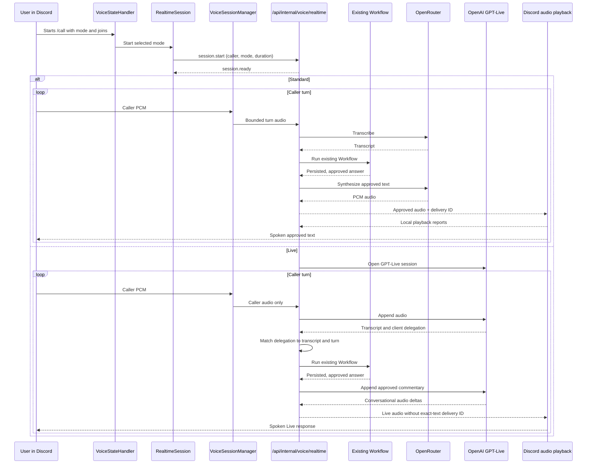

# Realtime Voice System

## Summary

Footnote's Discord bot receives speech and plays replies in a voice channel. The
bot handles Discord audio; the backend handles providers, Workflow and usage
records. Discord connects to `/api/internal/voice/realtime`, not directly to
OpenAI.

PR #965 adds two modes. **Standard** uses OpenRouter to transcribe speech and
synthesize the Workflow-approved answer. **Live** uses GPT-Live for conversation
and delegates substantive requests to the same Workflow. GPT-Live can also speak
on its own or paraphrase approved commentary. The
[alignment tracker](../status/realtime-voice-alignment.md) lists the tests and
remaining gaps. Neither mode has been tested with paid providers or a real
Discord call.

## High-Level Flow

## Current mode implementation

`/call` lets the caller choose `standard` or `live`; `VOICE_DEFAULT_MODE`
sets the default. Calls last up to 60 seconds. The configured developer can
request five minutes with `extended`. Set `DISCORD_USER_ID` to that person's
Discord user ID in both the backend and bot process, not to the bot's ID.
Without it, the backend rejects extended calls.

Only the initiating caller's audio is forwarded. The backend checks caller
identity, and the call ends if another person joins or the caller mutes, deafens
or leaves.

### Standard

`internalVoiceRealtime.ts` bounds each PCM turn, sends it to the OpenRouter
transcription adapter and runs the existing Realtime Workflow. The approved
exact answer is passed to OpenRouter TTS. Discord starts playback only with the
single-use delivery handoff, reports local start/completion/interruption/failure,
and stops stale playback on caller interruption. Synthesis is a complete PCM
artifact; Discord streams it through the existing guild playback pipeline.

### Live

`openAiLiveVoice.ts` owns the GPT-Live WebSocket on the backend. Discord sends
only the initiating caller's audio. The handler bounds transcript fragments and
associates client delegation events with the current transcript/turn before
calling the same Workflow. Missing or ambiguous transcript evidence fails
closed. Only a persisted, approved Workflow answer is appended as commentary.
GPT-Live may also speak without delegation and may paraphrase that commentary;
Live audio therefore carries no exact-text approval or playback receipt.

### Answer length

`voice.max-answer-tokens` defaults to 160. It caps the text delivered to
speech, not the model's generation budget, and it is not a target length.
Generation still follows TRACE. The limit does not raise Tightness or remove
needed reasoning, attribution or qualifications.

The backend estimates answer tokens because the available providers do not
share a tokenizer. It estimates ASCII letters and spaces in groups of three,
counts other ASCII characters once, and weights each non-ASCII code point by
the greater of two or its UTF-8 byte length. It does not split on English
spaces, but it is not an exact provider token count. Live uses the lower of the
configured ceiling and 400 estimated tokens, leaving 20% below the GPT-Live
500-token commentary-event maximum. Standard uses the lower of the configured
ceiling and 1,600 estimated tokens, plus a 3,686-code-point cap below the TTS
provider's 2,000-token and 4,096-character input limits. These provider limits
are internal safeguards, not additional settings. ([Live commentary limit](https://developers.openai.com/api/reference/resources/live/sideband-websocket),
[speech input limits](https://developers.openai.com/api/reference/resources/audio/subresources/speech/methods/create))

If an answer passes ordinary assessment but exceeds the delivery limit,
Workflow can run one `condense` Step. The Step uses the approved draft, permitted
context and evidence, review findings, TRACE settings, and the measured overage.
Its output is a separate Result that must pass assessment again. Answers that
already fit do not make this extra model call.

If condensation fails, remains too long, or fails reassessment, the Workflow
answer is not handed off for speech. It does not start another recovery pass or
increase the configured limits to force an answer through. Live can still
speak independently. The backend checks length again before approval, and both
provider adapters enforce their own transport limits. Standard sends the exact
approved text to TTS; GPT-Live may paraphrase approved commentary, so its
handoff is not evidence of exact-text playback.

Canonical Voice receipts include only content-free length measurements,
outcomes, Result/candidate references, timing, usage, and cost. They do not
retain prompts, questions, conversations, retrieval bodies, assessment text,
or answer drafts. The [Workflow documentation](./workflow.md#voice-answer-condensation)
explains the Step's lineage, limits, and failure behavior.

A [six-case synthetic evaluation fixture](../../packages/backend/test/fixtures/voiceCondensationEvaluation.json)
is available, but no provider comparison has been run. Condensation accuracy,
TRACE fidelity, latency, tokens, and cost remain unverified with real models.

Provider failures close the selected mode; they do not switch to another
provider or mode. Realtime call state and transcript content are transient.
Provider retention, real audio timing, quality, complete usage/cost and local
playback on Discord are not verified by synthetic tests.

## Retained legacy adapter settings

The exported `openAiRealtimeVoiceRuntime` adapter remains in `agent-runtime`
with package-level tests, but the backend does not wire it into `/call`.
Standard uses OpenRouter and Live requires GPT-Live; neither mode falls back to
the legacy adapter. The old `REALTIME_DEFAULT_MODEL`,
`REALTIME_DEFAULT_VOICE`, and `/call voice` settings have been removed. The
remaining VAD and greeting settings below describe the legacy adapter and do
not configure the current call modes.

| Setting                           | Default            | Allowed Values                         | Purpose                                                                                                                              |
| --------------------------------- | ------------------ | -------------------------------------- | ------------------------------------------------------------------------------------------------------------------------------------ |
| `REALTIME_GREETING`               | `Hey, {bot} here.` | String (non-empty, supports `{bot}`)   | Greeting text sent when the session starts.                                                                                          |
| `REALTIME_TURN_DETECTION`         | `server_vad`       | Enum (`server_vad`, `semantic_vad`)    | Selects provider-side turn handling strategy.                                                                                        |
| `REALTIME_VAD_THRESHOLD`          | provider default   | Number (`0`-`1`)                       | Optional server VAD sensitivity threshold.                                                                                           |
| `REALTIME_VAD_SILENCE_MS`         | provider default   | Integer (`>= 0`)                       | Optional provider silence window used to close a turn. Also used by Discord-side silence-tail injection when `server_vad` is active. |
| `REALTIME_VAD_PREFIX_MS`          | provider default   | Integer (`>= 0`)                       | Optional provider prefix padding so the provider keeps some audio before speech start.                                               |
| `REALTIME_VAD_CREATE_RESPONSE`    | provider default   | Boolean (`true` or `false`)            | When true, provider auto-creates a response after a detected turn.                                                                   |
| `REALTIME_VAD_INTERRUPT_RESPONSE` | provider default   | Boolean (`true` or `false`)            | When true, new user speech can interrupt an in-flight response.                                                                      |
| `REALTIME_VAD_EAGERNESS`          | provider default   | Enum (`low`, `medium`, `high`, `auto`) | Optional semantic VAD eagerness for `semantic_vad`.                                                                                  |

## Legacy OpenAI Realtime system breakdown

## 1. Discord Entry and Session Start

The Discord entrypoint is the `/call` slash command in [call.ts](../../packages/discord-bot/src/commands/call.ts). That command joins the target voice channel, records the initiating user, and optionally records a per-call voice override.

The actual realtime session does not start just because the bot joined the channel. The bot waits for the initiating user to join and start the conversation. That orchestration lives in [VoiceStateHandler.ts](../../packages/discord-bot/src/events/VoiceStateHandler.ts).

When conversation start is triggered, `VoiceStateHandler`:

- builds participant context
- creates the Discord-side realtime session wrapper
- attaches audio playback listeners
- initializes Discord audio capture
- sends the configured greeting

The bot waits for a participant instead of opening a provider session while alone in the channel.

## 2. Discord-Side Realtime Session

The Discord-side session wrapper lives in [realtimeService.ts](../../packages/discord-bot/src/utils/realtimeService.ts). Its job is to hide the backend websocket protocol from the rest of the Discord bot.

This layer:

- connects to the trusted backend websocket
- sends `session.start` with voice options and participant context
- streams PCM audio as `input_audio.append`
- sends greeting and other text turns
- normalizes backend events into local audio/text/completion events

This is intentionally not the provider boundary. It is only the Discord-to-backend transport layer.

## 3. Audio Capture and Turn Closing

Discord audio capture lives in [AudioCaptureHandler.ts](../../packages/discord-bot/src/voice/AudioCaptureHandler.ts). It subscribes to Discord voice receiver streams, decodes Opus to PCM, resamples the audio, and emits `audioChunk` events to the session manager.

Discord voice activity mode can stop sending audio immediately when the user stops speaking. That means the provider may not observe enough trailing silence to close a turn on its own.

To compensate, [VoiceSessionManager.ts](../../packages/discord-bot/src/voice/VoiceSessionManager.ts) listens for `speakerSilence` events and appends a short silence tail when `server_vad` is active. The silence length is derived from `REALTIME_VAD_SILENCE_MS`, clamped to a safe range. That design lets provider-side VAD stay authoritative while adapting to Discord's voice-activity behavior.

Discord streams audio while someone speaks. The provider still decides when their turn has ended.

## 4. Backend Trusted Boundary

The backend websocket handler lives in [internalVoiceRealtime.ts](../../packages/backend/src/handlers/internalVoiceRealtime.ts). This is Footnote's trusted internal boundary for Discord realtime sessions.

Its responsibilities are:

- authenticate the trusted websocket upgrade
- validate client events against `@footnote/contracts/voice`
- create and own one backend realtime session
- forward normalized events back to Discord
- record backend-owned usage and cost data on `response.done`

Discord uses this handler for realtime voice rather than opening its own provider websocket.

## 5. Prompt Composition

### Current Standard and Live calls

At call admission, the backend resolves and freezes the configured bot persona:
ID, display name, aliases, overlay and expression strength. An operator overlay
wins over the bundled catalog; without one, Danny, Myuri and Winter use their
bundled overlays, and Footnote uses its default persona layer. Custom identities
require an overlay. Missing, empty or rejected required overlays return
`voice_persona_unavailable` before provider startup rather than substituting
Footnote. There is no `/call` persona selector.

Standard and Live delegation carry this call-scoped resolution through the
existing `RealtimeWorkflowRunner` context into normal chat prompt assembly,
generation, assessment and presentation. The private persona data stays outside
the conversation snapshot and metadata-only Voice receipts. Corrections and
interruptions do not re-resolve identity. Profile expression overrides precede
catalog defaults (`strong` for Winter, `balanced` otherwise); ordinary chat
retains its request-override precedence. Speech model, voice and delivery remain
separate settings. Persona cannot alter TRACE, assessment or execution authority.

GPT-Live startup currently receives the pinned display name, generic listening
and delegation instructions, and acoustic delivery guidance. It does **not** yet
receive the resolved behavioral overlay or expression guidance. Startup parity
and listening evaluations are subsequent slices of #974; independently spoken
or paraphrased Live output is not Workflow-approved speech.

### Legacy realtime composer

[realtimePromptComposer.ts](../../packages/backend/src/services/prompts/realtimePromptComposer.ts)
is not used by the current Standard or GPT-Live handler. It builds legacy
Realtime instructions using:

- the shared conversational system layer
- the realtime voice surface layer
- one active persona layer (profile overlay when present, otherwise shared Footnote persona plus the realtime persona supplement)
- the current participant roster
- optional recent transcript summary

Realtime reuses the shared prompt-layer renderer and profile-overlay formatter, but it does not use normal chat's full request context, Context Steps, or model-input assembly. Its active profile is the backend's configured bot profile for the session.

## 6. Provider Runtime Adapter

The provider adapter lives in [openAiRealtimeVoiceRuntime.ts](../../packages/agent-runtime/src/openAiRealtimeVoiceRuntime.ts). This adapter is responsible for:

- opening the OpenAI realtime websocket
- sending the initial `session.update`
- applying the configured voice and turn-detection settings
- waiting for the provider session to become ready
- translating provider events into Footnote-owned normalized events

This is the only place that should know the provider websocket details for realtime voice. Discord and the backend boundary work in Footnote-owned contracts, not provider-native payloads.

## 7. Event Return Path and Playback

Provider events are normalized by the runtime, forwarded through the backend websocket handler, and consumed by Discord's realtime event layer in [RealtimeEventHandler.ts](../../packages/discord-bot/src/realtime/RealtimeEventHandler.ts).

That event layer emits streamed audio chunks immediately so playback can begin before the full response completes. Playback is then handled by [AudioPlaybackHandler.ts](../../packages/discord-bot/src/voice/AudioPlaybackHandler.ts), which keeps a guild-local playback pipeline alive long enough to avoid clipping between chunks or turns.

Audio streams in both directions:

- user audio goes Discord -> backend -> provider
- model audio goes provider -> backend -> Discord playback

## 8. Observability and Logging

Realtime voice uses structured logging across Discord, backend, and runtime layers. The logging favors:

- session lifecycle logs
- speaking start/end signals
- response completion logs
- warnings and errors

It avoids noisy per-chunk logs and keeps the default debug output focused on lifecycle and failure signals.

The backend remains the authoritative owner of realtime usage and cost recording. Discord may display or log completion metadata, but provider cost accounting is backend-owned.

## 9. Design Constraints

The current system is built around a few explicit constraints:

- Discord owns Discord UX, not provider session semantics.
- Backend owns the trusted voice control-plane boundary.
- Provider-specific websocket logic stays inside the runtime adapter.
- Server VAD remains authoritative for turn completion in the normal path.
- Discord voice-activity behavior is accommodated with silence-tail injection instead of moving turn closure back into Discord logic.

These boundaries keep provider-specific details out of Discord and Footnote's shared contracts.

## Alignment with normal chat

Realtime is a separate streaming session, not another route through
`POST /api/chat`. The maintained [alignment tracker](../status/realtime-voice-alignment.md)
records implemented behavior, intentional differences, gaps, evidence, and issue
ownership relative to ordinary chat.

Voice uses text chat's Workflow, model profiles, routing, planning, caching,
cost accounting and fallback settings. Both modes apply their own input checks
before starting Workflow. Voice can answer and use approved read-only tools;
it checks answers before speech and holds at most one pending delivery.

The process-wide Workflow reservation stays occupied until work settles, even
if the call ends. A 60-second execution deadline and a 5-second cancellation
watchdog flag work that has not stopped. These paths have synthetic tests, but
no paid provider or real Discord call has been tested.

Canonical Voice storage is metadata-only; operator-controlled diagnostics have a
separate boundary described below. The [Talker–Reasoner proposal](../proposals/realtime-talker-reasoner.md)
describes the remaining conversational work under #558. The alignment tracker
records implementation evidence and process-local recovery limits. Cross-surface
continuity and durable consent/retention policy remain under #559.

## Voice data handling

When someone agrees to Voice processing, Footnote can send the conversation
context needed for a response to the configured model provider. That consent
doesn't cover saving transcripts, audio, answer drafts or long-term memories, or
using call content in later text conversations. The backend excludes that content
from Footnote's canonical records. Approved answer text stays in a limited
in-memory delivery slot until it is handed off or discarded.

Voice also skips Footnote's optional `FOOTNOTE_DEBUG_CAPTURE_MODEL_IO` capture,
even if a debug session is already active. Ordinary text can still use that
feature. Free-form backend logs are suppressed during Voice Workflow.

These limits apply to Footnote's records, not every diagnostic system.
VoltAgent 2.11.0 captures model inputs, outputs, messages and tool data. Its
default trace store is in memory. Setting `memory: false` disables the Agent's
conversation memory, but not tracing; setting remote sampling to `never` also
leaves local traces intact (see the [VoltAgent documentation](https://voltagent.dev/docs/observability/developer-console/)).
Footnote's VoltAgent logger can write diagnostic files under the configured
logging directory's `voltagent` subdirectory. The log level is configurable,
and files rotate over 30 days. Those files may contain conversation content, so
operators need to control access and explain how they handle diagnostics.

Footnote configures a VoltOps client only when both `VOLTAGENT_PUBLIC_KEY` and
`VOLTAGENT_SECRET_KEY` are set. VoltOps can send diagnostic content outside the
host; Voice does not require it. Without those keys, local capture still runs.
Operators are also responsible for any custom SDK instrumentation or trace stores.

Voice shares text chat's model routing, prompt caching and supported fallbacks.
The direct OpenAI structured planner requests `store: false`, but that doesn't
establish the provider's overall retention policy. Before enabling live Voice,
operators need to understand and disclose the selected providers' processing,
caching and retention behavior.

Voice receipts keep provider and model labels only when they match configured
catalog entries, including normalized model names. Unexpected labels are omitted
on both success and failure; `modelVersion` becomes `unknown` when necessary.
This prevents a provider-supplied label from copying conversation text into a
receipt. Usage and cost numbers remain available, and routing is unchanged.
Aborted provider calls are not retried. Other recoverable failures follow the
configured Workflow retry and fallback rules.

## Final-response approval and staging

Finishing a Workflow does not mean Footnote can speak its answer. In
`realtimeWorkflowScope.ts`, the backend checks the selected candidate and its
assessment. `chatService.ts` passes along the selected text before dropping
candidate bodies, and `chatOrchestrator.ts` checks that it matches `runChat`'s
response. Text chat is unaffected.

Footnote issues a receipt only after storing execution metadata. Before
approving speech, it checks that exactly one answer candidate was selected and
that its text matches the output. An initial or revised candidate comes from
`generate`; a condensed candidate comes from `condense` and must link to the
previous approved draft. The final `assess` Step must review the selected
`draft` Result, produce a `review` Result, and return `finalize`. Both the Run
and Workflow must finish with `goal_satisfied`. Approval means the answer
passed review, not that it is necessarily true or private.

| Observed evidence                                              | Voice disposition        |
| -------------------------------------------------------------- | ------------------------ |
| Selected final draft with all required evidence                | `approved`               |
| No assessment, including assessment skipped by mode/policy     | `unassessed`             |
| Failed, unparseable or incomplete assessment evidence          | `assessment_failed`      |
| Last assessment asks for revision                              | `revision_requested`     |
| Last assessment asks for more retrieval                        | `search_requested`       |
| Missing/ambiguous candidate selection, text or draft linkage   | `selection_unverified`   |
| Finalized draft but Run/Workflow did not complete successfully | `workflow_not_completed` |
| Non-answer, terminal action or unsupported candidate stage     | `unsupported_response`   |
| Selected answer exceeds its Voice delivery limit               | `answer_too_long`        |
| Condensation or reassessment exceeds Workflow limits           | `workflow_limit_reached` |

Only `approved` carries text. For `workflow_limit_reached`, `limitReason`
identifies `budget_exhausted_steps`, `budget_exhausted_tokens`,
`budget_exhausted_time`, or `max_deliberation_calls_reached`.
These dispositions do not replace Run status or Workflow termination reasons. A revision needs its own final assessment; an
earlier accepted draft cannot approve later text. Budget-limited, failed and
fail-open paths retain their actual evidence and cannot authorize an answer.
Tool clarification and status copy do not enter this reviewed-answer slot.
Whether any unassessed or unresolved fallback should later be spoken remains
unresolved; this implementation withholds it. Trace alignment describes metadata
alignment, not a second content approval decision.

`RealtimeConversationState` holds at most one answer, bounded to 16 KiB of UTF-8
text. A 30-second handoff deadline starts when the answer is staged. At handoff,
a fresh 30-second deadline starts for the adapter's playback-start report; a
timely report clears it. The slot binds the initiating turn, intent revision,
call instance, private session ID, audience IDs, Run, response, candidate and
assessment/generation Steps. `completedExecution()` still exposes only identity,
execution status and review disposition.

The delivery slot tracks permission to speak separately from playback reports:

| Operation                                               | Effect                                                                                                                       |
| ------------------------------------------------------- | ---------------------------------------------------------------------------------------------------------------------------- |
| Workflow stages an eligible answer                      | `ready`; no playback reported                                                                                                |
| `requestDelivery(handle)`                               | Rechecks session/instance, audience consent, intent and deadline; moves once to `requested`, returning metadata without text |
| `startDelivery(deliveryId)`                             | Rechecks those conditions at the intended playback boundary; returns exact text once and moves to `handed_off`               |
| `reportPlayback(deliveryId, 'started')`                 | Records the adapter's start report, not a grant of permission                                                                |
| `reportPlayback(deliveryId, 'completed')`               | Records completion only after a start report; handoff alone cannot complete delivery                                         |
| `reportPlayback(deliveryId, 'interrupted' or 'failed')` | Records an incomplete outcome after handoff, whether or not a start was reported                                             |

`deliveryStatus()` returns a detached, content-free snapshot. Its `status` records
authorization (`ready`, `requested`, `handed_off`, `revoked`, `expired`); `playback`
separately records what the adapter reported. `handedOffAt` is backend time and
`startReportedAt` is receipt time, not a reconstructed audio timestamp. This
distinguishes no handoff, an unconfirmed start, and reported partial playback.
Duplicate reports, completion before start, reports before handoff and callbacks
for another delivery ID are rejected. Each new staged answer gets a fresh ID.

Text is removed from the slot at handoff, revocation or expiry. Until start is
reported, expiry remains active even after handoff. Every boundary checks the
clock as well as the timer, so a delayed timer cannot authorize stale text.
A timely start report clears that deadline: it is a start limit, not a maximum
playback duration. Only content-free evidence remains while playback finishes.

Interruptions and ambiguous user input discard text and revoke that
execution's ability to stage later text, while reasoning may continue. An explicit
continuation resumes intent but cannot restore revoked speech; a new question is
needed. Corrections, cancellation, roster/consent changes and disconnect also
discard text. Captured execution revisions and a delivery revocation counter
prevent late callbacks from restoring it. Expiration clears the body and leaves
the completed Run outcome intact. Revocation does not rewrite a playback start
as a confirmed stop. Ordered late reports about the last handoff may still update
playback evidence while its authorization remains revoked or expired; they never
restore text or permit a retry. Closing clears the entire slot, and replacing it
causes old callbacks to be ignored. Cancellation remains a request until settlement;
it does not prove remote work, audio or billing stopped.

Standard calls these operations before synthesizing and before local playback;
the Discord adapter reports local playback state and stops queued/playing audio
on interruption. Live calls them before appending approved commentary, but its
spoken rendition is model-controlled and has no exact-text delivery receipt.
Audio may already have played by the time the backend revokes permission. Even
a playback report cannot prove someone heard the answer, and delivery is not
guaranteed exactly once.

The provider adapters, call lifecycle and local playback path are implemented
with synthetic tests. Durable replay, transcript retention, memory and public
Trace extension remain out of scope. Process-local capacity and recovery gates
remain in force; provider cancellation and billing stop are not established by
local session closure.
