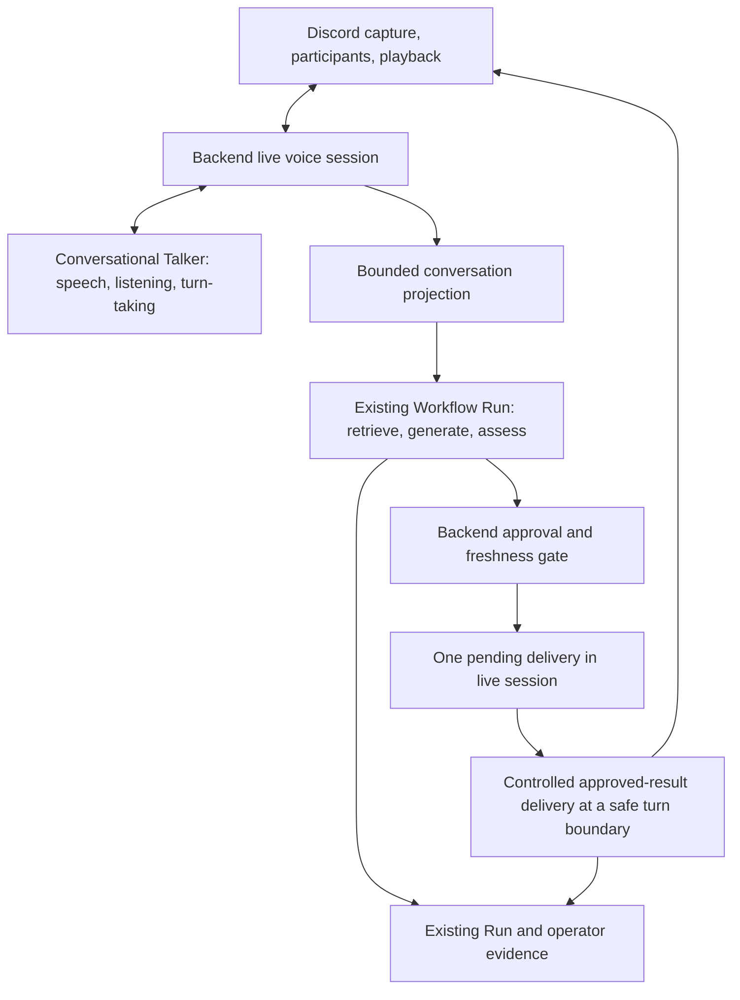

# Realtime conversation with background reasoning

Status: call state and bounded background Workflow execution implemented with synthetic events; final-result approval, speech and live wiring remain proposed. Updated 2026-10-29.
Primary owner: [#558](https://github.com/footnote-ai/footnote/issues/558).
Conversation continuity and retention remain governed by
[#559](https://github.com/footnote-ai/footnote/issues/559).

## Recommendation

Separate conversational responsiveness from substantive answering. A lightweight
Talker listens, acknowledges, manages attention, and speaks approved material.
The existing backend Workflow performs planning, retrieval, generation,
assessment, revision, and policy decisions asynchronously. Its approved output
can arrive after the next conversational turn.

Start with one active call, one pending question, and one deliverable result.
Keep their state beside the backend Realtime session. Reuse the workflow core,
conversation projection, speech resolver, and execution records. Do not add a
conversation database, event bus, agent framework, or general-purpose coordinator.
The [alignment tracker](../status/realtime-voice-alignment.md) records what exists;
everything below describes proposed behavior unless explicitly identified as current.
The first slice now has a backend-local state boundary and synthetic tests; see
the [implemented foundation](../status/realtime-voice-alignment.md#synthetic-call-state-foundation).
The next slice now starts bounded background Runs through the existing orchestrator;
see [implemented Workflow admission and capacity](#implemented-workflow-admission-and-capacity).
Neither slice connects live provider events or delivers speech.

The intended Talker is a lightweight conversational model: it listens and speaks
naturally, manages turn-taking and interruptions, and maintains attention while
the Workflow reasons independently. It must not wait for a complete STT →
Workflow → TTS cycle to acknowledge or respond to conversational cues. It cannot
authorize a Run, select privileged context, or invent a substantive answer.

Fixed acknowledgements and synthesis of approved text are an infrastructure
validation path for correlation, authority, freshness, and playback. They are
not the final Talker design or evidence that its responsiveness has been achieved.
Natural conversational output and substantive answer delivery need distinct
controls: the former may acknowledge, clarify, or report backend-known status;
the latter may convey only approved material. How a chosen model/adapter
enforces that distinction is an explicit design and evaluation gate, not a
problem solved by prompting. Free-form paraphrasing of substantive results
remains deferred until it preserves the approval boundary.

## What the references establish

These are design references, not dependencies or Footnote evaluation results.

| Reference                                                                                                                                                                                    | Pattern to borrow                                                                                                                                                                                                                         | Limit for Footnote                                                                                                                                                                                                                                               |
| -------------------------------------------------------------------------------------------------------------------------------------------------------------------------------------------- | ----------------------------------------------------------------------------------------------------------------------------------------------------------------------------------------------------------------------------------------- | ---------------------------------------------------------------------------------------------------------------------------------------------------------------------------------------------------------------------------------------------------------------- |
| [DeepMind, Agents Thinking Fast and Slow (2024), sections 3.2–4](https://arxiv.org/html/2410.08328v1)                                                                                        | The Reasoner updates beliefs and plans in shared memory; the Talker reads the latest available state, which can lag. It may wait for reasoning.                                                                                           | This is an architectural proposal with a qualitative sleep-coaching case study. Borrow the separation and delayed updates, not automatic memory retention or unrestricted Talker answers.                                                                        |
| [Google ADK: Sessions, State, and Memory](https://github.com/google/adk-docs/blob/main/docs/sessions/index.md), [State](https://github.com/google/adk-docs/blob/main/docs/sessions/state.md) | Session events/history, working state, and searchable long-term memory are distinct. Event `state_delta` updates go through session services; temporary invocation state has a different lifetime.                                        | Use explicit, serializable state changes at backend boundaries. This does not require ADK, durable event sourcing, or copying its user/app state scopes.                                                                                                         |
| [LiveKit Agents: Subagent delegation](https://docs.livekit.io/agents/logic/patterns/subagent-delegation/)                                                                                    | Nonblocking work acknowledges before completion; separate reasoning context, duplicate rejection, cancellation, and follow-up delivery help coherence. Late results need explicit handling because newer turns or handoffs can hide them. | These are documented framework techniques. Footnote should reuse its Workflow, not install LiveKit or inherit the example's permission to answer simple questions freely. Cancel the underlying work where possible, not just its filler.                        |
| [UW ConvFill: Thinking While Speaking (2026)](https://convfill.cs.washington.edu/)                                                                                                           | Semantically complete knowledge chunks can reach a Talker between spoken phrases; knowledge and speech queues separate reasoning latency from first response latency.                                                                     | The authors report results for trained small models and their study, not Footnote. Do not assume arbitrary hosted voice models accept mid-generation knowledge. Start with one final approved result; independently reviewed incremental chunks are future work. |

Shared state here means bounded, authorized working context, not hidden reasoning
or a general shared mutable Workflow object. Conversational latency (hearing an
acknowledgement) and reasoning latency (hearing an approved answer) must be
measured separately. No latency or financial improvement is demonstrated here.

## Conversation, session, and execution identity

| Concept                 | Meaning in this proposal                                                                                              | Existing seam / minimal extension                                                                                                                                                                                        |
| ----------------------- | --------------------------------------------------------------------------------------------------------------------- | ------------------------------------------------------------------------------------------------------------------------------------------------------------------------------------------------------------------------ |
| Conversation            | A bounded exchange with an audience, active intent, and profile. It is a domain entity even when only held in memory. | Initially one new call is one conversation. A separate durable entity or cross-surface ID is unnecessary until #559 settles lifecycle rules.                                                                             |
| Session                 | A live Discord/backend/provider connection with a finite lifetime.                                                    | Reuse the backend's private random `sessionCorrelationId`; a provider session ID remains adapter detail. Reconnect starts a fresh scope initially.                                                                       |
| Participant             | A member of the current audience, with surface-derived identity and consent state.                                    | Reuse voice participant IDs/labels; names and inferred speaker recognition are not authorization. Backend needs participant changes, not only the startup roster.                                                        |
| Turn                    | One finalized attributed utterance, or one actual assistant delivery.                                                 | Reuse envelope role/speaker/time metadata. Current `turn_0`-style IDs are request-local indexes; allocate stable in-call turn IDs at ingress. Overlapping speakers may need clarification before a question is admitted. |
| Run                     | One execution of an existing Workflow.                                                                                | Keep the Reasoner Run distinct from each existing `realtime_response` Run. Correlate both privately to the call and initiating turn. A connection is not a Run.                                                          |
| Result and presentation | A Step's named runtime value, and its user-facing spoken representation.                                              | `produced` does not mean approved. Keep the chosen final Result/response identity and review disposition through delivery. Playback is a representation, not a new substantive answer.                                   |
| Trace                   | A projection of execution evidence.                                                                                   | Reuse operator execution reporting. Public Trace is neither conversation history nor a channel for private call state.                                                                                                   |

Chat currently maps `request.sessionId` to `CorrelationEnvelope.conversationId`;
the web UI keeps a component-local session ID. Realtime's private correlation ID
does not establish text/voice continuity. Do not rename these contracts or map a
Discord channel/guild to a global conversation as part of #558.

The [conversation context proposal](./conversation_context_boundary.md) and
`conversationContextService.ts` already separate runtime `messages` from a
backend-owned envelope of participants, turns, visibility, authority, and
diagnostics. The service builds a request projection; it owns no live registry,
Run lifecycle, or memory store. Reuse its projection rules for a bounded snapshot
of finalized voice turns. Minimally separate projection input from
`PostChatRequest` if needed; do not fabricate a web request or promote the
service into a coordinator. Preserve one history source per Attempt. The current
assembler marks every accepted turn `model_visible` with `conversation`
authority; it does not check consent or audience permissions. The voice caller
must exclude non-shareable turns before projection, or introduce the smallest
scoped projection input for that check. The helper's visibility filter alone is
not an audience authorization boundary.

## Flow and ownership

1. Finalized, attributed user input updates the bounded in-call context. The
   backend decides whether it is an addressed question, clarification, cancel,
   or ordinary attention signal. Neither raw audio nor every VAD segment starts
   a Run. Unclear addressing gets a brief clarification.
2. Admission initially permits answering and allowlisted read-only Context
   Integrations only. Backend policy must constrain the available actions/tools
   before execution; planner suggestions cannot widen that set. Deny terminal
   action routes outside this answer-only scope. Side effects or broader actions
   require a separately approved voice authorization/confirmation design; a
   voice utterance or its transcript alone is not that authorization.
   After admission and duplicate checking, record a local pending handle and
   intent revision, acknowledge once, then invoke the existing backend
   `chatOrchestrator.runChat` service path without awaiting it in the audio/event
   handler. Pass the bounded snapshot, active profile/scope, and AbortSignal.
   Reuse policy resolution and Context Integrations rather than calling the
   public chat HTTP endpoint or the generic engine without its policy setup.
3. Keep listening while the promise runs. Attach completion, rejection, and
   cleanup handlers. This is in-process asynchronous execution, not an existing
   durable job API. The current service returns final metadata; do not invent
   an early Run ID. Bind its canonical Run/response ID when available, or make
   only the smallest identity extension if inspection must begin before completion.
4. A backend gate selects the final allowed response and holds a delivery in
   memory. It never forwards planner text, raw retrieval, a draft, review
   rationale, or arbitrary named Workflow Results to the Talker.
5. At a safe speaking boundary, recheck eligibility and speak the approved text.
   Record delivery status separately from Run success. Provider completion is
   not evidence that Discord played the audio or that the audience heard it.

The workflow remains the Reasoner; no extra reasoning agent wraps it. Existing
Context Integrations and `buildModelInput` retain retrieval scope, advisory
evidence roles, source reporting, and backend-owned prompt ordering.

## Implemented Workflow admission and capacity

The synthetic backend boundary now uses `RealtimeConversationState.startExecution`
and `chatOrchestrator.runRealtimeConversation`. The latter supplies the accepted
conversation projection directly to the existing `runChat` service, including
its normal planner, policy, Workflow and Context Integration setup. It does not
call a public HTTP endpoint, install another Reasoner or add a conversation coordinator.

Settled decisions for this slice:

- Voice always uses canonical Workflow execution, including when the configured
  text mode is `express`; mode selection cannot bypass Run creation.
- Admission requires the runtime's explicit `supportsEphemeralContent` guarantee.
  Absence fails before planning, provider execution or storage. **The current
  VoltAgent adapter is unsupported:** installed SDK 2.11.0 automatically records
  inputs, outputs and messages in local/WebSocket tracing, with no supported
  per-call opt-out. Remote-export sampling and missing credentials do not disable
  local capture. Only synthetic runtimes supply the guarantee in this slice.
  A separately verified adapter privacy control is an architectural prerequisite
  for live wiring; this slice does not replace SDK observability or add a runtime.
- Voice execution permits text answering plus the explicit read-only allowlist
  `weather_forecast` and `web_search`. The execution continuation denies other
  terminal actions. Context executor selection denies other integration names
  before either registry or fallback execution. Provider-native search is denied
  at the provider boundary, including search hinted by retrieved evidence.
- A backend-only async scope prevents voice work from inheriting text persistence.
  It injects no account memories, attachments, text session identity or private
  retrieval scope. Storage allowlists execution identity/status, timing, usage,
  cost, limits and validated machine decisions, including tool clarification
  reasons/counts and search recovery outcomes. Free-text summaries and review
  rationale are withheld; fixed placeholders preserve canonical schema validity.
  Citations, queries, drafts, candidates, debug bodies and publication tokens are
  excluded. Free-form logs and model debug capture are suppressed within voice
  work. No transcript-derived hash is retained.
- The call retains completion identity/disposition only, with no answer body or
  delivery slot. Freshness is not approval, and completion cannot authorize speech.
  Approval and controlled result delivery remain the next separate slices.
- The sole capacity reservation belongs to the backend process, outside call
  instances. Admission is synchronous; invocation and settlement are asynchronous.
  Duplicates and occupied slots are rejected without queuing replacement work.
  The canonical Run ID binds when the existing Workflow creates it; the response
  ID binds when metadata is assembled. Private initiating-turn correlation never
  becomes a text message ID or public Trace field.
- The execution deadline is **60 seconds**, with an independent **5-second
  cancellation watchdog**. Cancellation is a request, not stop evidence. Both
  deadline paths revoke completion eligibility and leave the slot occupied and
  observably degraded if work has not settled. New reasoning requests are rejected
  while call-state listening/control events remain usable. Only settlement releases
  capacity and clears its timers; there is no force-release or confirmed-stop API.
- `/api/admin/executions/realtime-pending` uses the existing account/admin
  authorization to expose metadata-only age, deadlines, cancellation, occupancy,
  degradation reason and available Run identity. Final records retain their normal
  response-ID lookup. No early response ID or fabricated terminal Run status is used.

The Workflow also restores its original AbortSignal after reading serialized plan
Results: a signal is runtime authority, not serializable plan data. Tests cover
real cancellation propagation and preserve failure Attempts without a provider retry.

This is process-local and remains disconnected from live provider events.
Crash/restart recovery and cross-process capacity ownership must be settled before
live wiring; reconnect protection here applies to the same backend process.
Restarting still does not prove remote work or billing stopped. Durable scheduling,
operator force-release, transcript continuity and provider evaluation are outside
this slice. The [tracker](../status/realtime-voice-alignment.md#synthetic-workflow-execution)
lists synthetic and disposable-storage evidence.

## Result and delivery rules

The following are session delivery states, not additions to the Workflow's
canonical status enums. A Run's observed facts must remain intact.
Fixed wording below describes infrastructure validation or a bounded fallback;
the target Talker may express the same permitted conversational intent naturally.

| State                        | Backend behavior                                                                                                                    | What the conversation may hear                                                                                                      |
| ---------------------------- | ----------------------------------------------------------------------------------------------------------------------------------- | ----------------------------------------------------------------------------------------------------------------------------------- |
| Pending                      | Keep one handle, intent revision, deadline, AbortController, and question/turn association. Deduplicate the same pending request.   | One fixed acknowledgement; optional bounded status on request. Silence is acceptable.                                               |
| Reviewed and eligible        | Require the selected final response, supported assessment evidence, permitted outcome, current audience/scope, and freshness.       | Approved text, with its limitations and source attribution preserved.                                                               |
| Failed or no approved answer | Preserve actual failure/review/budget disposition. Do not relabel a degraded or unreviewed fallback as approved.                    | A fixed failure/limitation message; offer to retry only through normal admission.                                                   |
| Cancelled                    | Revoke delivery first, abort work where supported, and record what actually stopped.                                                | Brief confirmation if useful. No claim that provider billing or external work was undone.                                           |
| Superseded                   | Increment intent revision; invalidate the old delivery and request cancellation. Start replacement only after capacity admission.   | Acknowledge the correction and eventually give only the new answer.                                                                 |
| Late                         | Recheck revision, deadline, session, audience, and whether the question is still outstanding. Time alone does not decide relevance. | Deliver at the next safe boundary only if still eligible, naming the question. Otherwise discard from voice delivery with a reason. |

The proposed approval predicate is deliberately stricter than "Run completed"
or "mode is reviewed." Some text modes gate assessment, and fail-open text
fallbacks exist. #558 must define an explicit mapping from current final
response/review outcomes to voice eligibility. Unsupported or ambiguous evidence
permits a status acknowledgement, not a substantive answer. This narrows voice
delivery; it does not silently change ordinary chat policy.

Recheck before enqueue, before playback, and after any interruption. Backend
session events serialize state transitions; completion callbacks must compare
the captured revision/session with the current values. No stale callback may
resurrect a cancelled delivery. Use the Run/Result plus presentation identity
for duplicate suppression during the live session. Do not promise exactly-once
audible delivery across disconnects or crashes; initially there is no replay.

## Attention, speakers, and interruptions

The Talker should attend to the addressed participant without treating their
voice as proof of account identity. An initiating user does not authorize
sharing another person's private context with everyone in the channel.
The backend chooses context scope appropriate to the whole current audience.
Audience or profile changes invalidate eligibility until scope is checked again.
Begin experiments with a single consenting human; ambiguous multi-speaker input
must not be routed under a guessed speaker's permissions.

New speech pauses or cancels queued playback immediately. Barge-in does not
automatically cancel reasoning: "yes, keep looking" preserves intent; "actually,
use tomorrow" supersedes it; "stop that search" cancels it. An uncertain topic
change holds delivery and asks whether the prior question still matters. Use
explicit corrections/cancels and revision changes first, not a second semantic
classifier framework. The backend remains the decision maker.

Approved results wait while a human speaks, while an acknowledgement plays, or
while a clarification is unresolved. Deliver one result at a turn boundary,
optionally with a fixed "About your earlier question" lead-in. Do not interrupt
for routine completion. High-priority interruption policy is deferred. A user
asking "anything yet?" can request the pending status without launching a second
Run. No unbounded timer-driven filler loop is needed.

The current adapter drops speech-start/stop from normalized events, does not
emit finalized user transcripts, and exposes no response cancel/truncate or
playback acknowledgement. Discord already captures speaker activity and streams
playback, but provider VAD interruption alone does not prove local queued audio
stopped. Those are bounded integration gaps, not assumed capabilities.

## Approval survives speech

Treat delivery as presentation of a selected approved answer, not another
unreviewed generation. Initially synthesize its exact text (or a separately
approved spoken rendition produced within the same workflow). Do not send
approved text as a synthetic `user` message and assume a voice model will
repeat it faithfully. The existing `input_text.create` does exactly that kind
of user-message insertion; it is not an authorized result-update channel.

Only backend-admitted conversational output and approved substantive deliveries
may enter the speaking path. During infrastructure validation, use fixed
acknowledgements and controlled synthesis. The intended conversational Talker
may realize acknowledgements, clarifications, and backend-known status naturally,
but must not convert those into unapproved factual answers. Its control path
must enforce that distinction and preserve the approved result's meaning;
instructions alone cannot establish enforcement. Uncontrolled answer audio must
be suppressed. If a provider cannot support the required control, STT plus TTS
can validate infrastructure but does not qualify it as the target Talker. A
failure of that control leaves the optional voice mode unavailable while text
stays usable.

Keep a private correlation tuple: session, initiating turn, intent revision,
Reasoner Run, selected Result/response, and delivery identity. Reuse existing
records for inference Attempts and backend cost; add only bounded delivery
metadata where missing. A speech generation Attempt remains observable without
pretending it reran reasoning/review. Preserve source categories, uncertainty,
and any citations in the approved rendition. Do not announce "verified" merely
because an assessment ran, expose hidden reasoning, or publish a call Trace
link automatically. Source-detail sharing needs an authorized surface/audience.

## Lifetimes, privacy, and limits

Live working context is an in-memory, bounded window of finalized turns and
pending delivery data. Retained history is stored content with a retention and
deletion policy. Long-term memory is separately selected cross-conversation
information. None implies permission to create either of the others.

The call sends speech to configured providers for processing even when Footnote
does not retain it. Disclose that processing and obtain the required participant
consent before experiments. A configured key is not evidence of provider
retention guarantees. No automatic transcript/audio storage, summaries, memory
writes, account-memory injection, or text/call transfer is proposed. Existing
text history/debug persistence hooks must not be inherited accidentally by
calling `runChat`; a voice caller needs a content-free persistence policy before
live wiring. Metadata-only Run records remain private to authorized operators.

Disconnect, consent withdrawal, or session expiry stops affected audio capture
and provider forwarding, revokes delivery, aborts pending work, and clears
ephemeral content/listeners/timers. For the first single-human slice, another
human joining pauses capture and delivery until processing consent and audience
scope are resolved, or the call ends. A new session gets no automatic replay.
Durable consent, deletion/export rules, history linking, and playback-setting history
are decisions for #559 before continuity implementation.

Reuse Workflow Execution Contract duration, token, tool, and Attempt limits.
Add explicit per-session caps for pending work (initially one), delivery count
(one), context bytes/turns, audio buffering, idle/max lifetime, and a result TTL.
Choose numeric time/byte limits in the first implementation with fake-clock
tests; these are not performance claims. A cancellation-ignoring Run continues
to occupy its capacity until it settles. If its deadline expires without a
confirmed stop, stop admitting replacement work; do not release capacity merely
because its result expired. Count listening, acknowledgement/synthesis, and
reasoning costs separately without duplicating the same provider usage. Unknown
usage remains unknown.

An independent deadline watchdog must turn that occupied slot into an explicit
degraded state even if the Run's promise never settles. At the deadline, revoke
delivery, request cancellation, and mark voice reasoning unavailable. Give one
bounded status at the next safe speaking opportunity: the earlier work has
stalled, so new questions cannot currently start. Continue listening and handling
stop/leave/status cues; reject new reasoning requests promptly with that reason
rather than silently waiting or growing a queue. Text remains independently
available under its own admission rules, not as an automatic retry of the Run.

Expose metadata-only pending age, deadline, cancellation-request time, occupied
capacity, and the degraded reason through existing operator diagnostics. Do not
report a confirmed stop or final Run failure without evidence. Recovery requires
settlement or a confirmed stop; then clear the reservation and report reasoning
available again. Closing or reconnecting a call must not bypass the unresolved
work reservation: retain only the minimal capacity/correlation metadata after
session content is cleared. If stopping cannot be confirmed, keep reasoning
explicitly unavailable and require operator recovery. A process restart alone
does not prove remote work or billing stopped. Choose the finite watchdog and
notification bounds in slice 2 and test them with a never-settling fake Run.

## Concrete exchanges

- **Slow lookup:** Alex asks for a comparison. "I'll check that" plays while a
  bounded Run retrieves and assesses evidence. Alex adds a short comment; the
  result waits until Alex stops speaking, then gives the approved comparison
  and its source limitations. The acknowledgement latency is not answer latency.
- **Correction during work:** Alex changes "today" to "tomorrow." The backend
  supersedes revision 1, requests cancellation, and admits revision 2 when
  capacity permits. Revision 1 finishes anyway; its result is recorded but never
  spoken. Revision 2 is delivered with the corrected date.
- **Barge-in and audience change:** During a result, Alex interrupts, then Blair
  joins. Playback stops locally, the partial delivery stays incomplete, and the
  result is held for audience/scope revalidation. It is not marked fully heard
  or automatically replayed to Blair.
- **No approved result:** Retrieval times out and assessment cannot approve a
  substantive fallback. The call says it could not complete the answer. The
  Talker does not fill the gap with a guess; ordinary text remains available.
- **Cancellation stalls:** A superseded Run ignores abort and never resolves.
  The watchdog marks reasoning unavailable and reports the stall once. New
  questions receive an immediate unavailable status; listening and call controls
  still work. Reconnecting does not start another Run against the held capacity.
  Only confirmed settlement/stop restores admission; otherwise an operator must
  recover it. No unapproved answer fills the gap.

## Provider feasibility is a separate decision

As of 2026-10-29, OpenRouter documents
[audio input/output in Chat Completions](https://openrouter.ai/docs/guides/overview/multimodal/audio),
including streamed audio deltas, and
[SSE response streaming](https://openrouter.ai/docs/api_reference/streaming).
It also documents separate
[STT](https://openrouter.ai/docs/guides/overview/multimodal/stt) and
[TTS](https://openrouter.ai/docs/guides/overview/multimodal/tts) HTTP endpoints.
These establish request/response audio capabilities. The reviewed pages and
[documentation index](https://openrouter.ai/docs/llms.txt) do not establish a
persistent bidirectional Realtime WebSocket session with VAD, cancellation,
dynamic result updates, and playback control. Treat that capability as
unverified, not supported merely because a model accepts audio.

OpenRouter is preferred for later experiments because the operator reports an
existing key; no direct OpenAI key is available for this phase. No credentials
were inspected and no provider call was made. Current backend wiring constructs
the OpenAI Realtime adapter only when a direct key is present; an OpenRouter key
does not activate it. Prefer a bounded STT → existing Workflow → controlled TTS
experiment if documented persistent Realtime support remains unavailable. That
tests delivery/latency, not full-duplex Realtime equivalence, and needs adapter
work: the existing TTS boundary returns a complete base64 artifact. This is an
infrastructure validation path, not the final Talker architecture. It must not
be used to close the conversational latency/turn-taking acceptance criteria.

Evaluate the intersection of provider/model features and the concrete adapter:
finalized input and speaker association, controlled speech, cancellation,
response identity, mid-session updates, audio format, usage completeness, and
privacy posture. Keep provider payloads, voice names, and WebSocket/tool details
inside adapters; shared conversation and Run contracts describe identities and
outcomes. Some current VAD option types still import OpenAI enums; normalize
only capabilities actually required by the selected experiment.

## Small follow-up sequence

Each row is an independently reviewable slice. The first two now have synthetic
implementation, with result retention/approval deferred to slice 3. The remaining
rows are proposed child scopes, not newly created issues or duplicate umbrellas.

| Order / owner                                                                                              | Scope                                                                                                                                                                                                                               | Acceptance evidence                                                                                                                                                                                                                                                                                |
| ---------------------------------------------------------------------------------------------------------- | ----------------------------------------------------------------------------------------------------------------------------------------------------------------------------------------------------------------------------------- | -------------------------------------------------------------------------------------------------------------------------------------------------------------------------------------------------------------------------------------------------------------------------------------------------- |
| 1 · #558; lifecycle constrained by #559                                                                    | Add in-call stable turn identity, intent revision, participant updates, and bounded projection beside existing session correlation. Exclude turns outside current audience/consent scope before projection; keep content transient. | Unit fixtures for identity, speaker ambiguity, trimming, audience/consent exclusions, teardown, and no text/voice ID merging. No provider or runtime rollout.                                                                                                                                      |
| 2 · #558                                                                                                   | Add one in-process pending execution handle and one delivery slot around the existing backend workflow service. Enforce answer-only/read-only action scope, voice-safe persistence, and canonical ID binding on completion.         | Deferred-promise tests show audio handling remains responsive; duplicate, failure, disconnect, and never-settling cancellation cases prove watchdog degradation, prompt rejection, observable recovery, and no reconnect bypass; no content persisted or disallowed tool/terminal action executed. |
| 3 · #558; use #709's accepted authority boundaries                                                         | Define explicit final-result eligibility, supersession/TTL rules, cancellation, and delivery evidence. No partial drafts.                                                                                                           | Fake-clock/race tests reject unassessed fallback, wrong audience/session/revision, stale and duplicate results; persistence failure cannot authorize speech. #709 is closed for its existing scope, not proof of voice enforcement.                                                                |
| 4 · #558; #534 owns speech defaults                                                                        | Extend the current Realtime boundary for a conversational Talker: listening and natural conversational output during reasoning, controlled approved-result updates, interruption, and playback status.                              | Fake-runtime/backend/Discord tests prove no autonomous answer escapes and local queued audio stops on barge-in. Capability absence is explicit; fixed TTS alone cannot complete this slice.                                                                                                        |
| 5 · Separate bounded provider/latency evaluation issue linked to #558; reuse #552/#957 for cache economics | Start with offline simulations, then an explicitly authorized OpenRouter experiment if feasible. Separate STT/TTS pipeline from persistent Realtime claims.                                                                         | Measure speech-end→acknowledgement audio, admission→approved result, ready→playback, complete answer latency, interruption stop delay, stale suppression, usage and total cost. No paid work is authorized by this proposal.                                                                       |
| 6 · #559                                                                                                   | Settle consent, audience changes, retention/deletion/export, cross-surface IDs, and historical playback settings in an ADR before broader continuity.                                                                               | Approved defaults and bounded child issues; tests prove transfer is opt-in and revocable. No new conversation framework assumed.                                                                                                                                                                   |

Public Trace exposure or a general durable job service, if later needed, warrants
its own concrete issue. #955 supplies caching policy/instrumentation and richer
text accounting; it proves neither Realtime cache observability nor incremental
savings. Keep the [cache evidence](../status/prompt-caching-status.md) separate.

## Alternatives and open decisions

Keeping one model and adding async Workflow tools could be smaller if that
adapter exposes the necessary controls. The current contract does not, so do
not assume it is sufficient. A full Talker–Reasoner agent framework, durable
queue, conversation store, or streaming knowledge-chunk protocol adds lifecycle
and privacy obligations without solving the first missing boundary. Defer them.

Progression from controlled TTS validation to a conversational Talker is part of
#558, not an optional polish phase. Before calling the target design delivered,
demonstrate listening and natural conversational responses during a pending Run,
barge-in recovery, coherent approved-result incorporation, and separate
conversational versus answer latency measurements. A successful serial audio
pipeline does not satisfy those criteria. The lightweight model and adapter
remain open choices; approval and provider feasibility remain hard gates.

Approval is needed for the proposed strict speech eligibility mapping, the
single-call lifecycle/defaults, and which provider experiment to pursue later.
Implementation must choose concrete resource limits and prove controlled speech,
speaker attribution, persistence exclusions, and delivery cancellation before
enabling this mode. #559 must separately settle continuity consent/retention;
this proposal supplies terminology and conservative defaults, not that ADR's
approval. No runtime behavior changes in this documentation pass.
